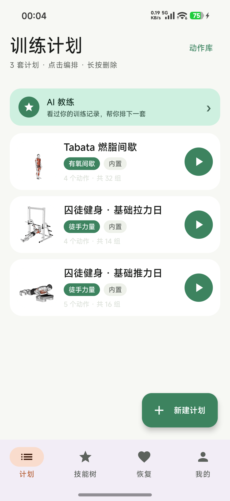
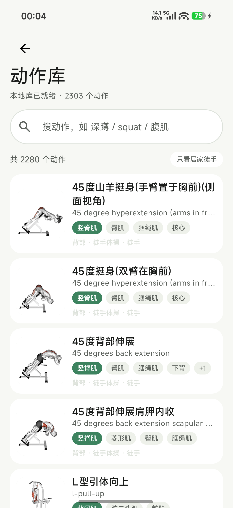
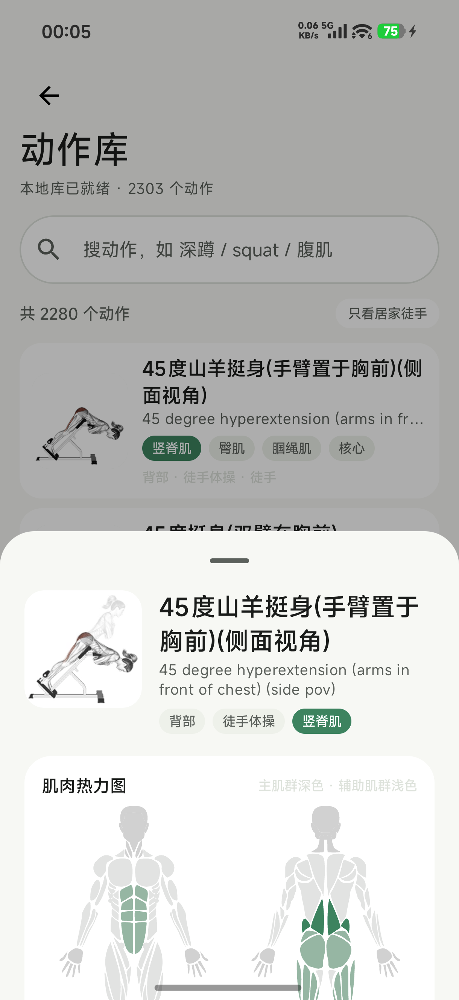
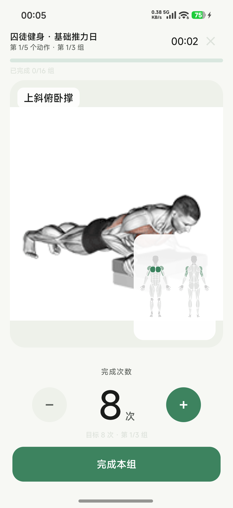
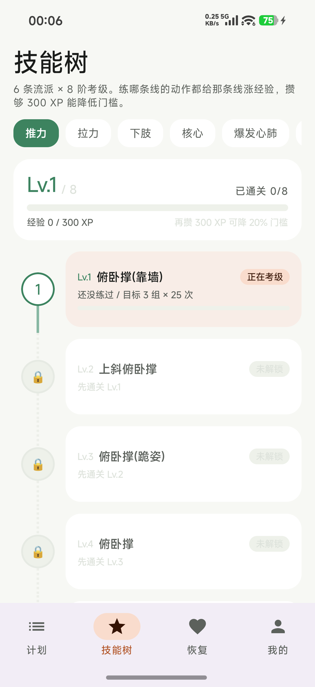
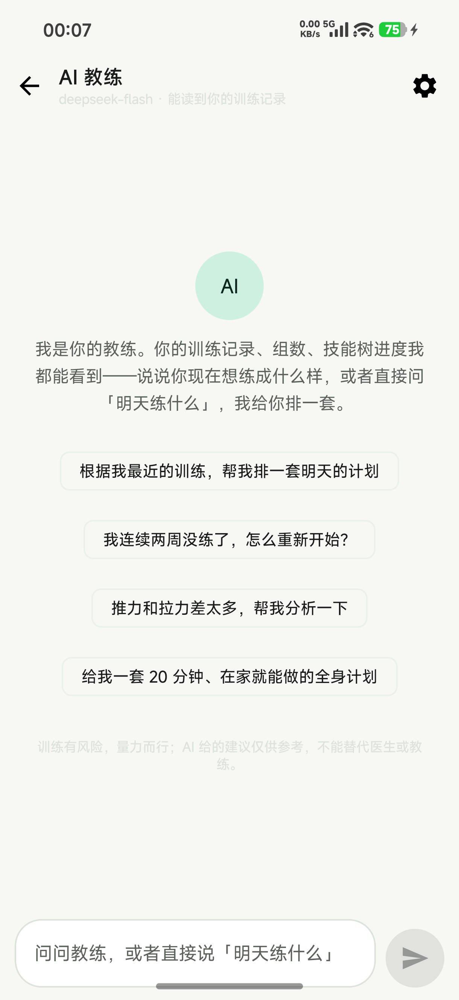

<div align="center">

# FitGym

离线优先的原生 Android 健身应用<br />
**2303 个动作 · 完整训练闭环 · 可选 AI 教练**

[](https://github.com/kylin33/AiFitGym/releases/latest)
[](LICENSE)
[](#开始使用)
[](gradle/libs.versions.toml)
[](#技术栈)

[下载 APK](https://github.com/kylin33/AiFitGym/releases/latest) ·
[开发与构建](docs/DEVELOPMENT.md) ·
[架构设计](docs/ARCHITECTURE.md) ·
[隐私说明](PRIVACY.md)

</div>

---

## 为什么做这个

健身应用大多停在「给你一套计划」这一步。真正劝退人的是第二天：这个动作做不标准怎么办、
两组之间该歇多久、练完了下次要不要加量、上周只练了一场今天要不要补。

FitGym 把这条链路做完整 —— 动作库、计划编排、跟练、记录、恢复，是同一个应用里的同一套数据；
AI 教练接在这套数据上，而不是另外开一个聊天窗口。

它不要求注册账号，不采集行为数据，断网也能练完一整套。

## 界面

<table>
  <tr>
    <td align="center" width="33%"><br /><sub>计划：点开可编排，右下角新建</sub></td>
    <td align="center" width="33%"><br /><sub>动作库：2303 个动作，中文名与肌群标签</sub></td>
    <td align="center" width="33%"><br /><sub>动作详情：演示图与肌肉热力图</sub></td>
  </tr>
  <tr>
    <td align="center"><br /><sub>跟练：准备倒计时、记次、自动进组</sub></td>
    <td align="center"><br /><sub>技能树：六条流派 × 八阶</sub></td>
    <td align="center"><br /><sub>AI 教练：能读到你的训练记录</sub></td>
  </tr>
</table>

## 它能做什么

### 动作库
2303 个动作（徒手、有氧、拉伸、瑜伽、康复），中英文名、演示图、目标肌群与所需器械。支持模糊搜索
（中文名、英文名、肌群名都能命中）与部位/器械筛选；常用动作带**动态演示短片**，冷门动作可按需下载。
动作、整份计划、练完后的恢复状态共用同一套人体图着色。

### 计划编排
装好之后是空的，没有预置模板 —— 组数、次数或秒数、组间休息、拖动排序、给每个动作配一个
「做不动时换什么」的平替，都按你自己的器械和水平来。嫌麻烦就先让 AI 排一套，
它给的目标余力（RIR）也会一起带过来，之后照样能手改。

### 跟练
计次与计时双模。3 秒准备提示音、自动进组、组间休息、屏幕常亮；换动作前的那次休息
会把下一个动作的演示图提前亮出来，不用歇完才发现要换器械。锁屏后由前台服务继续倒数，
通知栏给「+15 秒 / 跳过休息 / 结束训练」。每一组完成即时落库 —— 训练到一半被杀进程，
回到首页会出现「有一场训练没做完」，可以接着练。

### 记录与恢复
历史记录细到每一组：实际次数、实际休息时长，以及和当时目标差多少。
恢复页按过去 72 小时的组数与时间衰减估算各部位状态，越红越该休息；
训练量视图看 7 天 / 30 天里各部位到底练了多少。

### 技能树
六条流派（推力 / 拉力 / 下肢 / 核心 / 爆发心肺 / 有氧耐力）× 八阶，48 个主干动作。
练哪条线的动作就给那条线涨经验，通关要满足组数、目标值与动作标准 —— 进阶不是靠「练得久」，
而是靠做得到。

### AI 教练（可选）
OpenAI 兼容端点，填自己的 Key（用 Android Keystore 加密存放）。能排计划、能回答
「我练得怎么样」，也能在每次练完后复盘一次，按实际完成度调整下一套计划。
复盘默认关闭，关着时不会自动发起任何请求。

## AI 教练和「聊天框 + 健身知识」的区别

**数字由 App 算好，模型只负责判断。** 7/30 天的场次、训练日、总组数、推拉腿分布、
每个动作单场最好成绩的走向、每个动作的达标组数与实际休息时长，都在本机算完再交给模型 ——
不指望语言模型从几百条原始记录里数对，也不会把几百条明细发出去。

| 程序算 | 模型判断 |
| --- | --- |
| 训练频率、组数、流派分布、动作趋势 | 这个量对他来说是不是突然加太多 |
| 距上次训练几天、每条流派最近一次是哪天 | 今天还能不能练同一个部位 |
| 每个动作达标几组、实际休息与计划休息差多少 | 这套强度是偏轻还是偏重 |
| 建议单次组数区间、休息区间的边界 | 这次排几个动作、每个几组、留几次余力 |

**提示词分四层，加训练类型不用动核心。** 角色与行为 / 用户动态上下文 / 训练决策规则 / 输出协议。
跑步、HIIT、核心专项、增肌、减脂、长期周期是第三层的可插拔模块：一句话纪律常驻，
详细规则在话题命中时才注入，最多加载两个。

**安全是两道，不是一句话。** 提示词里区分肌肉疲劳、延迟性酸痛、关节疼痛与训练中突发异常，
分不清时按更严重的处理；落库前还有一道程序检查：伤病部位会牵动的动作、总组数超过建议上限、
某条流派今天刚练过又排了九组以上 —— 以警告形式出现在计划卡片上。

**改计划先给清单。** 复盘给出的改动会先列成「新增 / 调整 / 删除 / 不变」四类，
点「应用」才写进数据库。

## 隐私

- **不需要账号**，没有埋点、没有广告 SDK、没有崩溃上报。
- **核心功能完全离线**：动作库、计划、跟练、记录、恢复、技能树都不联网。
- **训练数据只存在这台手机**，可以导出成一份 JSON 带走，换机或重装都能搬回来。
- **AI 是可选功能**：只有你自己填了端点与 Key 才会发请求；发送内容是训练摘要与候选动作清单，
  不含每组的原始记录，也不含具体日期。详见 [PRIVACY.md](PRIVACY.md)。

## 开始使用

**直接安装**：从 [Releases](https://github.com/kylin33/AiFitGym/releases/latest) 下载 APK，
需要 Android 7.0（API 24）以上。debug 与 release 包名不同，可以共存。

**自己编译**：

```bash
./gradlew :app:assembleDebug      # 调试包
./gradlew :app:assembleRelease    # R8 + 签名
./gradlew :app:testDebugUnitTest  # 69 个单元测试
```

需要 JDK 25 与 Android SDK 37；没有 `keystore.properties` 也能构建出未签名的包。
环境、签名、CI 与素材生成的细节在 [docs/DEVELOPMENT.md](docs/DEVELOPMENT.md)。

## 技术栈

| 层 | 选型 |
| --- | --- |
| UI | Jetpack Compose + Material 3，Navigation Compose |
| 数据 | Room 2.8 + KSP（导出 schema），kotlinx.serialization |
| 媒体 | Coil 3 读演示图，Media3 ExoPlayer 播放循环短片 |
| 后台 | 前台服务 + 通知栏控制，播放用 SoundPool（带音频焦点闪避） |
| 网络 | `HttpURLConnection` + 手写 SSE，不引 SDK |
| 构建 | AGP 9.5 / Kotlin 2.4.21 / Gradle 9.8.2，手写依赖注入 |

数据表设计、热力图配色、检查点、状态机、AI 提示词的分层与取舍，都写在
[ARCHITECTURE.md](docs/ARCHITECTURE.md) 里。

## 文档

- [docs/DEVELOPMENT.md](docs/DEVELOPMENT.md) — 环境、构建、测试、CI、素材生成
- [docs/ARCHITECTURE.md](docs/ARCHITECTURE.md) — 数据模型、渲染、AI 与安全策略
- [PRIVACY.md](PRIVACY.md) — 数据存在哪、什么时候会离开这台手机
- [DISCLAIMER.md](DISCLAIMER.md) — 训练风险与 AI 生成内容的局限
- [CONTRIBUTING.md](CONTRIBUTING.md) — 提交规范与 CLA

## 许可与素材

代码以 **AGPL-3.0** 发布，见 [LICENSE](LICENSE)。

内置素材的授权条件与代码不同：动作数据、演示图与短片来自
[openGym](https://github.com/DuarteSantos8/openGym)，其图片与短片版权属于 **Gym visual**，
上游仅获授权用于 openGym 本身。非商业 fork 可原样保留并附声明；
**商用或上架应用商店需自行取得授权**，或替换成自有 / CC0 素材。
人体图几何数据来自 **MuscleMap by Melih Colpan**（MIT）。完整声明见 [NOTICE](NOTICE)。

---

<div align="center">
<sub>训练有风险，量力而行。本应用与 AI 生成的建议不能替代医生或教练的当面评估。</sub>
</div>
